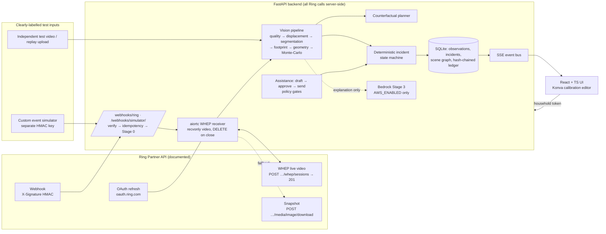
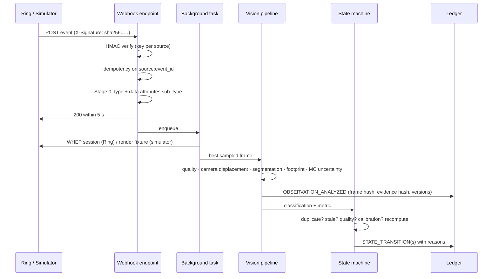
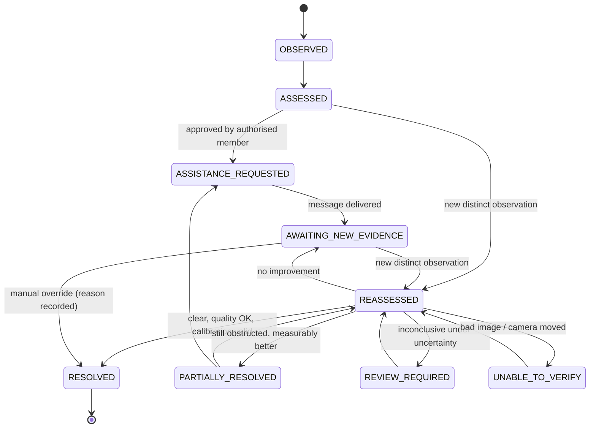

# Architecture

## System overview

## Event flow (one observation)

## Incident state machine

Rejected evidence (identical frame content, or captured earlier than the incident's latest evidence) is recorded as `EVIDENCE_REJECTED` and never changes state.

## Vision pipeline

| Stage | Method | Output |
|---|---|---|
| Image quality | contrast-normalised Laplacian focus (320 px), luminance, clipping, block texture loss vs reference | `usable` + reasons |
| Calibration validity | ORB landmarks + RANSAC similarity vs clear-scene reference | `STABLE` / `DISPLACED` / `UNCONFIRMED` |
| Segmentation (Stage 1) | LAB change detection vs reference, robust illumination gain, chroma-preserving shadow suppression, Ring watermark strips ignored, connected components | instance masks + confidence |
| Ground contact | lowest silhouette pixel per column; frame-border truncation flagged; elevated vertical edges trimmed using the **vertical vanishing point recovered from the floor homography** | contact polyline |
| Footprint | metric: contact projected to floor (cm), far edge at depth `D` along contact-edge normal, `D` bounded by projecting the silhouette top; apparent: lower silhouette band | polygon |
| Geometry (Shapely) | intersection, fraction, intrusion depth, gap, cross-section minimum clear width | measurements |
| Uncertainty | 160 Monte-Carlo samples: mask ±3 px, unseen depth/band, floor-point jitter σ=1.5 px | `p_obstructed`, p5–p95 envelope |
| Decision | p ≥ 0.9 obstruction · p ≤ 0.1 clear · otherwise review; unreliable contact touching the route → review | classification |
| Counterfactual | grid search of translations into the drop zone with safety margin; nearest clearing position otherwise | proposed footprint |

## Data & privacy

* Only the selected evidence frame and its annotated copy are stored; no video is persisted. Retention purge removes media but keeps hashes in the ledger.
* Per-household access tokens (hashed in DB); every route is household-scoped.
* Ring tokens are server-side only; rotated tokens encrypted with Fernet.
* Ledger: per-household SHA-256 hash chain; SQLite triggers abort UPDATE/DELETE (DELETE only via explicit household data deletion).
* No face recognition, no identity inference, no door control, no automatic sharing.
